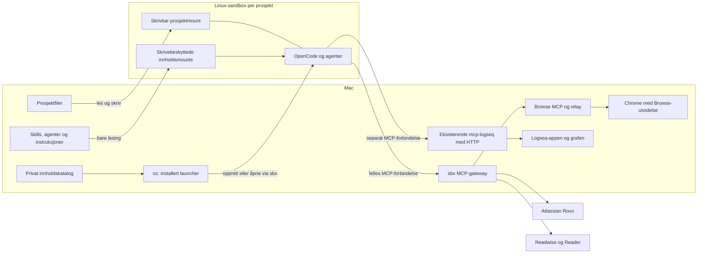
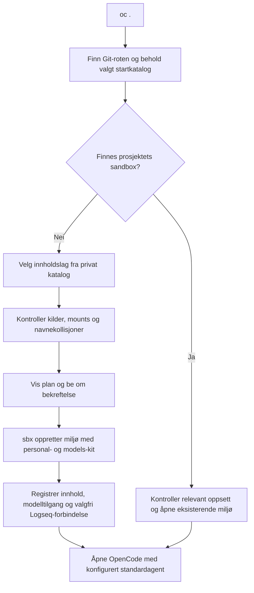
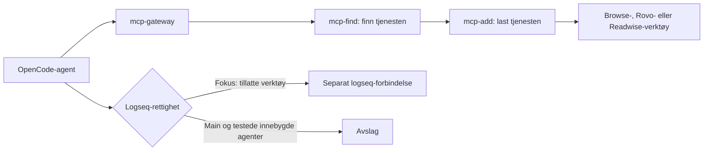

# OpenCode i Docker Sandboxes

Gjenbrukbart Linux-miljø for OpenCode, med **én utskiftbar sandbox per prosjekt**. Prosjektmappen monteres skrivbart. Nye miljøer kan i tillegg få skrivebeskyttede innholdsmounts. Varig arbeid skal ligge i prosjektmounten eller eksterne systemer.

Oppskriftene hører hjemme i `mac-setup`. Innlogging, API-nøkler, databaser og samtaler skal ikke i Git eller images.

## Leseguide

- Denne siden forklarer arkitekturen, daglig bruk og feilsøking.
- [CONTENT-MOUNTS.md](CONTENT-MOUNTS.md) beskriver katalogformat, mounts og kollisjonskontroll.
- [MCP.md](MCP.md) beskriver transport, autentisering og agentrettigheter.
- [HISTORY.md](HISTORY.md) inneholder historiske testresultater og tidligere løsninger.

Figurene er Mermaid-diagrammer som GitHub viser direkte.

## Oversikt: hva kjører hvor?



### Hva er standard, og hva er egen kode?

| Del | Ansvar |
| --- | --- |
| Docker Sandboxes (`sbx`) | Sandboxruntime, kit, mounts, secrets/proxy og MCP-gateway. Dette er eksisterende Docker-funksjonalitet. |
| OpenCode | Sesjoner, agenter, skills, Code Mode og verktøyrettigheter. |
| Browse, Rovo, Readwise og `mcp-logseq` | Eksisterende MCP-tjenester for nettleser, Atlassian, lesebibliotek og Logseq. |
| Koden i dette repoet | Launcher, katalogbasert innholdsvalg, kit og små adaptere som kobler delene sammen. |
| Privat vertskonfigurasjon | Valg av innholdskilder, innlogginger og tokenfiler. Ligger utenfor det offentlige repoet. |

`logseq.py` starter den installerte `mcp-logseq` med HTTP-transport og eget
MCP-token. Det opprettes ingen ny Logseq-app eller kopi av grafen.
På den oppsatte Macen starter en bruker-LaunchAgent denne forbindelsen ved
innlogging. Browse håndterer relayen selv ved bruk; ingen egen Browse-LaunchAgent
skal installeres.

## Fra `oc .` til arbeidsklar sandbox



Nye miljøer får innholdet automatisk når vertskatalogen er satt opp.
Personlig innhold kan være et alltid aktivt lag, jobbinnhold kan velges etter
mappe, og produktinnhold kan avgrenses til en bestemt repository-identitet.
Bare ett lag leverer agentmappen. De konkrete reglene ligger i den private
katalogen, ikke i launcherkoden.

Eksisterende miljøer migreres ikke. Ved ufullstendig førstegangsoppsett beholdes
miljøet; rett årsaken og bruk et nytt navn. Ingen automatisk reparasjon eller sletting.

### Oppdateringer og byggecache

Ved opprettelse av nye miljøer bruker launcheren `--pull always`, slik at
publiserte kit-images sjekkes mot registeret fremfor å bruke standardvalget
`missing`. `opencode` velger normalt `docker.io/sbx/opencode:latest`;
en konfigurert `kit.shortcuts.opencode` kan velge en annen referanse.
Dette oppgraderer ikke eksisterende sandboxer.

Lokale mixiner bygges med cache når kildefiler og kitargumenter er uendret.
`--pull always` er ingen garanti for nybygging av lokale mixiner.
Digesten i `personal/personal.dockerfile` låser mixinens byggegrunnlag.
En mixin tilfører bare filene Dockerfilen legger til eller endrer, så denne
digesten låser ikke i seg selv workloadens OpenCode-versjon.

Kilder: [Docker: kitreferanser og cache](https://docs.docker.com/ai/sandboxes/customize/use-kits/),
[Docker: mixininnhold](https://docs.docker.com/ai/sandboxes/customize/author/tool-mixins/)
og `sbx create --help`.

## Hvorfor vises bare `mcp-gateway` og `logseq`?

Dette er de to sandboxforbindelsene OpenCode kjenner. Browse, Rovo og Readwise ligger bak
gatewayen og lastes ved behov.



- **Browse, Rovo og Readwise:** registreres én gang på Macen. Agenten bruker gatewayens
  oppdagelsesverktøy og henter eksakt kallsti med OpenCodes `search`.
- **Logseq:** ligger separat for å kunne avgrense entydige `logseq_*`-verktøynavn
  med OpenCodes agentrettigheter. Gatewayens generelle videresendingsverktøy
  ga ikke denne avgrensningen alene.
- **Agentbytte:** kobler ikke Logseq fra. Forbindelsen består, mens agentens
  rettigheter avgjør om verktøyene kan brukes.
- **Fokus:** er den personlige OKR-assistenten, tidligere kalt Logseq-agenten.
  Den har vanlig verktøytilgang og et tydelig mandat om mål, kapasitet og læring.
  Modellvalget er Kimi K3.1 Pro fra Berget. Som subagent bruker den dette valget;
  et bytte av hovedagent endrer ikke automatisk modellen i en eksisterende sesjon.
- **Readwise:** er registrert og autorisert i felles sbx-katalog. Oppdagelse,
  lasting og verktøykatalog er testet fra en dynamisk sandbox uten å hente bibliotekinnhold.
  Macens direkte Readwise-forbindelse er autorisert separat. Gatewayen tilbyr
  også skriveverktøy; Fokus skal vise endringer og vente på ja før de brukes.
- **Skriving:** kjente Logseq-skriveoperasjoner bruker `ask`. «Allow always»
  kan lagre en godkjenning, så ny tillatelsesdialog ved hvert skriv er ikke garantert.
- **Sikkerhetsgrense:** dette er modellens verktøyrettigheter. Agenter med
  vilkårlig shell-/fil-/nettverkstilgang deler sandboxbruker og kan omgå dem.
  Nye agentdefinisjoner og nye upstream-verktøy krever gjennomgang.

### Browse og to forskjellige JavaScript-miljøer

OpenCodes ytre `execute` har verktøytilgang gjennom `tools`. Det har ingen
`page`, `browser` eller `snapshot`. I Browse-versjonen brukt under testene
16. november 2026 hadde Browse dessuten sitt eget `execute`, som tok
Playwright-kode som en streng:

```javascript
// Inne i OpenCodes execute, etter oppslag av verktøyets eksakte kallsti:
return await tools["mcp-gateway"].execute({
  code: 'await page.goto("https://www.nrk.no/"); return await page.title();'
});
```

Dette eksemplet er **versjonsavhengig**. Nyere Browse-verktøykataloger tilbyr
blant annet `navigate` og `snapshot` med en eksplisitt tab-ID i stedet.
Bruk alltid katalogen som faktisk er lastet, og følg dens signaturer.
Ekstra parametere som `session` gjør ikke OpenCodes ytre `execute` til Browse.
Ved `Unknown identifier 'page'` må det faktiske verktøykallet kontrolleres før
en versjonsoppdatering foreslås.

## Hva ligger hvor, og hva overlever?

| Innhold | Plassering | Stopp/start | Sletting av sandbox |
| --- | --- | --- | --- |
| Prosjektfiler | Prosjektmappen på Macen, skrivbart montert | Beholdes | Beholdes |
| Skills, agentfiler og fellesinstruksjoner | Egne innholdskilder på Macen, lesbart montert | Beholdes | Beholdes på Macen |
| Installerte launcherfiler | `~/.local/share/opencode-sbx/launcher-mcp-v2/` | Uavhengig av sandboxen | Uendret |
| Innholdsvalg | `~/.config/opencode-sbx/catalog.json` | Uavhengig av sandboxen | Uendret |
| Logseq-profil og MCP-token | Privat Mac-konfigurasjon og state | Uavhengig av sandboxen | Uendret |
| OpenCode-samtaler og filer bare inne i sandboxen | Sandboxens egne data | Testet bevart | Må sikres separat; ingen garanti om gjenoppretting |
| Kopierte kitfiler, som `preferences.md` | Sandboxens hjemmekatalog | Beholdes | Ny sandbox får filene fra valgt kit |

Levende innholdsmounts gjør vertsendringer synlige i sandboxen. OpenCode kan
trenge `/reload` eller en ny sesjon før endringene brukes. Allerede innlastet
samtaleinnhold erstattes ikke automatisk.
Kopierte kitfiler oppdateres verken av en ny agentsesjon eller av endringer i repoet.

## Verifisert og gjenstående

Sist gjennomgått 17. november 2026. Funksjonstestene nedenfor ble kjørt
16. november med `sbx` 0.53.0 og OpenCode 2.3.0:

- 154 enhetstester bestod ved siste kodeendring.
- Ny sandbox opprettet gjennom installert launcher med innholdslag,
  modelltilgang, standardagent og separat Logseq-forbindelse.
- Logseq-agentens lesing og Mains avslag testet; syntetiske skrivekall
  stoppet på godkjenning uten at de nådde testtjenesten.
- Browse åpnet NRK gjennom gateway og faktiske modellkall. To naturlige
  forespørsler med Sonnet 5 bestod etter instruksjon om riktig kallform.
- Rovo-innlogging, dynamisk lasting og verktøykatalog bekreftet.
  Ingen funksjonstest mot Jira-/Confluence-innhold er gjort.
- Innholdsoppsett, rettighetskontroller og samtaledata er testet over stopp/start.

Dette er konkrete tester av det oppsatte miljøet, ingen garanti for alle
modellvalg, fremtidige MCP-versjoner eller gjenoppretting etter sletting.

## Første oppsett på en Mac

Du trenger Docker Sandboxes (`sbx`), Python 3.9 eller nyere på verten og OpenCode på Macen. `sbx` har sin egen runtime; vanlig Docker Desktop-daemon er ikke nødvendig for arbeidsflyten nedenfor.

### Felles utviklingsbasis

`personal` legger til Python 3 med virtuelle miljøer, Node 24 LTS med npm/npx,
`uv`, `actionlint`, `yamllint` og `shellcheck`, i tillegg til personlig shell
og editor. Git, GitHub CLI, jq, ripgrep og make finnes i den gjennomgåtte
OpenCode-workloaden. Python brukes som `python3`.

Node, uv og actionlint har eksplisitte versjoner i Dockerfilen og nedlastinger
kontrolleres mot utgiverens SHA256-lister. Python, yamllint og shellcheck følger
pakkekildene i mixinens byggegrunnlag. npm og PyPI er tillatt i kitets
nettverkspolicy, fortsatt underlagt eventuell overordnet policy.

Installer prosjektavhengigheter fra prosjektets avhengighetsfiler.
PyYAML og pytest er eksempler på prosjektavhengigheter; de installeres ikke
globalt. Bruk isolerte Python-miljøer og unngå å dele `.venv` eller
`node_modules` mellom Mac og Linux. Sandboxens egen hjemmekatalog kan brukes
til slike lokale miljøer; innhold der må kunne gjenskapes ved sletting.

Java, .NET, native kompilatorer og større nettleseroppsett er ikke del av denne
basisen. Java og .NET kan senere leveres som valgfrie V3-mixiner ved opprettelse.
Launcheren har foreløpig ingen velger for slike tillegg.

Kjør `sh sbx/scripts/check-environment.sh` inne i sandboxen fra dette repoet
for å kontrollere verktøy og personlig konfigurasjon. Pakkeinstallasjon og
nettverkstilgang må testes separat.

Basisoppsettet ble funksjonstestet 17. november 2026 i en ny, mountløs
ARM64-sandbox med OpenCode 2.3.0: Node 24.22.3, uv 0.13.9, actionlint 1.7.12,
yamllint 1.37.1 og ShellCheck 0.10.0. Isolert installasjon av PyYAML fra PyPI
og `npm ci` fra npm-registeret bestod. Alle tre validatorer godtok gyldige
testfiler og avviste ugyldige testfiler. Miljøkontrollen bestod også etter
stopp/start. Ingen modellkall eller prosjektmount ble brukt. AMD64 er ikke
funksjonstestet. Testen brukte repoets kit, ikke den installerte launcherens
kitkopi på Macen.

Kontroller og logg inn fra terminalen:

```sh
sbx version
sbx login
sbx secret set openai --oauth
opencode auth list
```

ChatGPT-innloggingen skal være registrert i `sbx` **før sandboxen opprettes**. Anthropic og Berget må ha aktive API-nøkkelinnlogginger i Macens OpenCode, slik at engangsoverføringen kan hente dem.

## Daglig bruk

`oc.py` gir én inngang for prosjektoppstart og eksisterende miljøer:

```sh
python3 ~/.local/share/opencode-sbx/launcher-current/oc.py           # Meny med navn, status og prosjekt
python3 ~/.local/share/opencode-sbx/launcher-current/oc.py .         # Opprett eller gjenåpne prosjektmiljø
python3 ~/.local/share/opencode-sbx/launcher-current/oc.py list
python3 ~/.local/share/opencode-sbx/launcher-current/oc.py open NAVN
python3 ~/.local/share/opencode-sbx/launcher-current/oc.py shell NAVN
python3 ~/.local/share/opencode-sbx/launcher-current/oc.py stop NAVN
python3 ~/.local/share/opencode-sbx/launcher-current/oc.py capabilities .
```

Kortkommandoen `oc` installeres ikke av scriptet. Den er lagt inn separat i brukerens dotfiles etter godkjenning. For gjeldende zsh-økt kan du definere:

```sh
oc() { python3 "$HOME/.local/share/opencode-sbx/launcher-current/oc.py" "$@"; }
```

Deretter er `oc`, `oc .`, `oc list`, `oc open NAVN`, `oc shell NAVN` og `oc stop NAVN` tilstrekkelig. Permanent shelloppsett gjøres separat i dotfiles etter godkjenning.

- Menyen lar deg velge miljø, så åpne OpenCode med Enter, terminal med `t` eller stoppe med `s`. `q` avbryter.
- I et Git-repo bruker `oc .` repo-roten som skrivbar mount og stabil sandboxidentitet, også når du står i en undermappe. Valgt undermappe beholdes som startkatalog. Et nestet repo bruker sin egen rot. Utenfor Git brukes mappen du oppgir.
- Git-roten kan ikke være hjemmemappen eller filsystemroten. Git-feil avbryter oppstarten. Arvede `GIT_*`-overstyringer ignoreres ved prosjektoppdagelse.
- Koblede worktrees, submoduler og andre repoer med Git-metadata utenfor prosjektroten avvises foreløpig ved prosjektoppstart. Ingen ekstra mount legges til, og worktrees slås aldri sammen med hovedrepoets miljø. Støtte krever egen mountavklaring.
- `oc shell NAVN` åpner zsh som `agent` i prosjektmappen, i gjeldende terminal. Utelat navnet for å velge fra menyen. Sandboxen starter ved behov. `exit` avslutter shelløkten; den kan holde sandboxen i gang så lenge den er åpen.
- Prosjektoppstart finner også miljøer med eldre navn. Hvis flere miljøer peker på samme prosjektmappe, må du velge. Uten interaktiv terminal må navnet angis med `--name`.
- Eldre miljøer som bare monterer en undermappe, migreres ikke og velges ikke automatisk som miljø for hele repoet. Bruk `oc open NAVN` for å gjenåpne dem med opprinnelig mount.
- Åpning starter en stoppet sandbox eller kobler en ny OpenCode-klient til samme miljø og historikk. Den garanterer ikke automatisk valg av en bestemt samtale. Separate miljøer krever separate terminalfaner.
- Åpning av et eksisterende miljø utfører ingen credential-registrering, kit-oppgradering eller skill-installasjon. Dette gjør også eldre OpenCode-miljøer tilgjengelige fra menyen.
- Stopp av et kjørende miljø krever bekreftelse og avbryter aktive prosesser. Et allerede stoppet miljø blir stående urørt.
- `open NAVN --dry-run`, `shell NAVN --dry-run` og `stop NAVN --dry-run` viser bare planen. `oc . --dry-run` bruker oppstartsscriptets lesende kontroll.
- `--all-tabs` gjelder åpning/prosjektoppstart. `--setup-only` og `--name` gjelder prosjektoppstart. Bruk `oc project STI` hvis mappenavnet er et reservert kommandonavn.
- Launcheren har ingen slettekommando, automatisk oppgradering eller egen
  bakgrunnsmodus. Dette er separat fra vertstjenester som Logseq-forbindelsen.

### Nye miljøer med innholdsmounts

`oc . --name NYTT-NAVN` bruker katalogformat 2 til å velge skrivebeskyttede
innholdsmounts. Alle kilder vises før opprettelse. Global hovedagent,
instruksjonsfiler og skill-kilder registreres i det nye miljøet, uten å
overskrive Docker-genererte providers eller global `AGENTS.md`.

Eldre miljøer åpnes uten ettermontering eller innholdsregistrering. Velg
et nytt navn for den nye løsningen. Ved feil under førstegangsoppsett
beholdes miljøet; rett årsaken og velg et nytt navn. Ingen automatisk
reparasjon eller sletting.

Før aktivering kreves en gjennomgått launcher utenfor prosjektmountene:

```sh
# Viser bare kopiplanen. Skriver ingenting.
python3 sbx/install-launcher.py ~/.local/share/opencode-sbx/launcher-mcp-v2
```

Installasjon med `--apply`, endring av `oc`-funksjonen og endring av privat
vertskatalog krever separat godkjenning. Eksisterende katalogformat 1 kan
fortsatt brukes for lesende lagvalg, men kan ikke opprette innholdsmounts.
`--catalog FIL` velger en eksplisitt katalog ved prosjektoppstart.

### Lesende lagvalg

`oc capabilities` viser hvilke innholdslag prosjektmappen skal få.
Utelatt argument betyr gjeldende mappe. Du kan også oppgi en sti eller et
eksisterende sandboxnavn:

```sh
oc capabilities
oc capabilities /sti/til/prosjekt
oc capabilities opencode-work
```

Den bruker en betrodd vertskatalog i `~/.config/opencode-sbx/catalog.json`.
Katalogen er privat vertskonfigurasjon og skal ikke fylles med credentials.
Bare lokal metadata leses; ingen sandbox startes eller endres.
`--catalog FIL` velger en eksplisitt katalogfil for kontroll.

**Denne kommandoen viser bare forventede lag.** Den installerer ikke
komponenter og beviser ikke at skills, MCP, agenter eller hovedinstruksjoner
er tilgjengelige. Lagvalg aktiverer ikke innholdslevering ved oppstart.

Format og sikkerhetsgrenser står i [CONTENT-MOUNTS.md](CONTENT-MOUNTS.md).

Når prosjektmappen er nøyaktig samme mappe som kilden til et innholdslag,
for eksempel `oc .` i `~/Dev/nml-skills`, monteres laget ikke en gang til.
`sbx` tillater ikke samme vertssti som både skrivbar og skrivebeskyttet mount.
Skills, instruksjoner og agenter leses da direkte fra den skrivbare
prosjektmappen. Agenten i sandboxen kan dermed endre sine egne instruksjoner
og agentdefinisjoner. Nestede mapper behandles som før.

Det opprinnelige oppstartsscriptet kan fortsatt brukes direkte:

`start.py` bruker nøyaktig mappen du oppgir som mount, uten automatisk Git-rot.
Bare `oc.py` utfører den nye prosjektoppdagelsen. Bruk `--workdir UNDERMAPPE`
med `start.py` for en annen startkatalog innenfor den eksplisitte mounten.

Kjør fra prosjektmappen, uavhengig av hvor `mac-setup` er klonet:

```sh
python3 ~/Dev/mac-setup/sbx/start.py .
```

Ved første kjøring:

1. Scriptet viser hvilken mappe som blir skrivbar og ber om bekreftelse.
2. `sbx` oppretter sandboxen med begge mixinene. Godkjenn nettverks- og credential-forespørslene i terminalen.
3. Manglende Anthropic- og Berget-nøkler registreres direkte fra Macens OpenCode, avgrenset til denne sandboxen.
4. OpenCode åpnes i prosjektet.

Senere kjøringer gjenåpner samme sandbox. Navnet avledes fra mappens navn og en hash av den absolutte stien. Flytting av prosjektmappen gir et nytt navn. Scriptet sletter eller gjenskaper aldri en eksisterende sandbox.

Scriptet monterer ikke hele `~/Dev` eller hjemmemappen. Direkte bruk uten `--content` krever én skrivbar prosjektmount og begge mixinene. Med `--content` kontrolleres i tillegg nøyaktig de valgte skrivebeskyttede innholdsmountene. Velger du selv en overordnet mappe som prosjekt, blir hele den mappen tilgjengelig. Velg derfor prosjektroten.

### Eksisterende arbeidsmiljø

Det verifiserte miljøet for dette repoet heter `opencode-work`:

```sh
python3 ~/Dev/mac-setup/sbx/start.py ~/Dev/mac-setup --name opencode-work
```

Uten `--name` får dette repoet et nytt, avledet navn. Bruk kommandoen over for å beholde den eksisterende historikken.

### Andre valg

```sh
# Lesende forhåndsvisning. Oppretter eller starter ingenting.
python3 ~/Dev/mac-setup/sbx/start.py . --dry-run

# Sett opp miljøet uten å åpne OpenCode.
python3 ~/Dev/mac-setup/sbx/start.py . --setup-only

# Egendefinert navn, som må brukes igjen ved senere oppstart.
python3 ~/Dev/mac-setup/sbx/start.py . --name opencode-mittprosjekt
```

Scriptet stopper ved feil. Hvis opprettelsen lyktes før et senere steg feilet,
beholdes sandboxen. Rett årsaken og bruk et nytt navn for en ny sandbox.
Eksisterende registrerte secrets overskrives ikke automatisk.

## Sesjoner og tabs

Flere OpenCode-sesjoner i samme prosjekt kan brukes som tabs i samme sandbox. Separate sandboxer har separate OpenCode-servere og databaser. Sesjonene deres samles ikke automatisk i én tabrad; bruk separate terminalfaner når du bytter prosjekt.

OpenCode støtter `tabs.scope: "global"` på tvers av mapper i samme server. Valget `--all-tabs` setter dette midlertidig for klienten, uten å endre Macens konfigurasjon eller gi flere filtilganger:

```sh
python3 ~/Dev/mac-setup/sbx/start.py . --all-tabs
```

Dette forener ikke separate sandboxer. Standardoppsettet holder én skrivbar prosjektmappe per sandbox.

## Livsløp: exit, stopp og sletting

| Handling | Konsekvens |
| --- | --- |
| Avslutt OpenCode | Agentøkten avsluttes. Sandboxen stopper automatisk når ingen økter holder den i gang. Den slettes ikke. |
| Åpne en zsh-økt i samme sandbox | Denne økten kan holde sandboxen i gang etter at OpenCode er avsluttet. |
| `sbx stop NAVN` | Stopper miljøet. Data beholdes til neste oppstart. Aktive prosesser avbrytes. |
| `sbx run --name NAVN` | Starter eller gjenåpner eksisterende miljø. |
| `sbx rm NAVN` | Sletter sandboxen. Filer i den delte prosjektmappen på Macen beholdes. |

Scriptet bruker verken `--detach` eller `--rm`. Miljøene kjører derfor ikke permanent og slettes ikke automatisk ved exit. `sbx`-bakgrunnstjenesten kan fortsatt kjøre på Macen selv om alle sandboxene er stoppet.

```sh
sbx ls
sbx inspect opencode-work
sbx exec -it opencode-work zsh -l
sbx stop opencode-work
```

Installerte programmer, shellhistorikk og OpenCode-data skal overleve stopp og oppstart så lenge sandboxen finnes. I det syntetiske testmiljøet er skills, eierskapsmetadata og en OpenCode-samtale med alle meldinger kontrollert før og etter stopp/start. Dette verifiserer ikke alle datatyper eller gjenoppretting etter sletting.

**Stopp er den vanlige handlingen når du vil frigjøre ressurser.** Behandle sletting som potensielt tap av intern historikk og filer. Noen kit-eide volumer kan overleve sletting, men vi har ikke verifisert hvordan denne kit-versjonen gjenkobler dem. Ta separat sikkerhetskopi før sletting. Git av prosjektet tar ikke backup av sandboxens interne data.

Ikke bruk `sbx run --rm`, `sbx prune` eller `sbx reset` som daglig avslutningskommando. `reset` fjerner også lagrede secrets. `--detach` holder et miljø kjørende etter at alle økter er avsluttet; det bruker vi ikke i dette oppsettet.

## Secrets

- `sbx` lagrer secrets i macOS Nøkkelring, ifølge Docker-dokumentasjonen.
- ChatGPT bruker global OAuth i `sbx`. Sandboxens tilgang avhenger også av kit og godkjenninger.
- Nye sandboxer får `openai/gpt-6.1-sol` som standardmodell, satt i `models/install.py`. Den settes bare når `model` mangler, og agenter med egen modell beholder den. Eksisterende sandboxer endres ikke.
- Anthropic og Berget registreres som sandbox-avgrensede API-nøkler.
- Proxyen på Macen setter inn ekte credentials for godkjente leverandørdomener. Sandboxen bruker plassholdere.
- Berget-mixinen begrenser credential-injeksjon til `api.berget.ai`.
- Nøkkeloverføringen bruker `opencode auth export` for én leverandør om gangen og standard input til `sbx secret set`. Ingen nøkkelverdier skrives til filer, kommandoargumenter eller utdata.
- De opprinnelige nøklene i Macens OpenCode beholdes. Overføringen er en engangskopi; senere nøkkelbytter synkroniseres ikke automatisk.
- Sandboxen kan bruke modelltilgangen og påføre kostnader selv om den ikke kan lese nøkkelen.
- `.env`-filer og andre hemmeligheter inne i den delte prosjektmappen er tilgjengelige for agenten.

Manuell kontroll eller registrering for en allerede opprettet sandbox:

```sh
python3 ~/Dev/mac-setup/sbx/scripts/register-model-secrets.py --sandbox NAVN
python3 ~/Dev/mac-setup/sbx/scripts/register-model-secrets.py --sandbox NAVN --apply
```

Ikke bruk dette scriptet som en dynamisk `--command`-kilde: repoet er skrivbart fra sandboxen. Engangsoverføring skal startes bevisst fra verten etter gjennomgang av koden.

## Struktur og oppdatering

```text
sbx/
├── oc.py            # Meny, liste, prosjektoppstart, åpning og bekreftet stopp
├── start.py
├── profiles.py      # Privat katalog og lagvalg
├── content.py       # Lesende mountplan og kollisjonskontroll
├── content_runtime.py # Registrering inne i en ny sandbox
├── install-launcher.py # Eksplisitt kopiplan for betrodd launcher
├── mcp.py           # Registrering av Browse og Rovo i felles sbx-katalog
├── mcp_host.py      # Start eksisterende Browse med gjennomgått vertsmiljø
├── logseq.py        # Privat vertskonfigurasjon og start av mcp-logseq HTTP
├── mcp_runtime.py   # Separat Logseq-forbindelse og native agentregler
├── personal/       # Shellverktøy, Nord, Powerline og instruksjoner
├── models/         # Berget-oppsett og credential-deklarasjon
├── scripts/        # Miljøkontroll og engangsoverføring av API-nøkler
├── tests/          # Enhetstester uten opprettelse eller sletting av sandboxer
└── HISTORY.md      # Verifiserte funn fra utprøvingen
```

Mixinene bygges og caches av `sbx`. De kan gjenbrukes mellom prosjekter, mens hver sandbox beholder egne data og avgrensninger. Kopierte personlige standardinnstillinger oppdateres manuelt fra gjennomgåtte kilder; Macens konfigurasjon er ikke montert.

Neovim-konfigurasjonen er kopiert fra Macen. Packer, Lualine, Nord og
nvim-web-devicons hentes i de samme versjonene ved bygging, slik at oppstart
ikke krever nedlasting av plugins. Eksisterende konfigurasjon og plugins
overskrives ikke. Eldre plugins i Macens `nvim/plugged` er ikke del av den
aktive Packer-konfigurasjonen og følger ikke med. Tilgang til Macens
utklippstavle fra sandboxen er ikke verifisert.

Endringer i repoet oppdaterer ikke den installerte launcheren automatisk.
`install-launcher.py` nekter å skrive over en ikke-tom målmappe. `oc` peker
derfor på den faste lenken `launcher-current`. En oppdatering installeres i en
ny mappe, og deretter flyttes lenken. `zshrc` trenger ikke endres:

```sh
python3 sbx/install-launcher.py ~/.local/share/opencode-sbx/launcher-v4 --apply
ln -sfn launcher-v4 ~/.local/share/opencode-sbx/launcher-current
```

Eksisterende sandboxer kan fortsatt gjenåpnes med `oc .` når mixinene kommer fra
en tidligere launcher under `~/.local/share/opencode-sbx/`. Oppdater også
eventuelle vertstjenester og MCP-registreringer som peker til den gamle
installasjonen før denne ryddes bort.

Endrede kitfiler krever en ny sandbox med nytt navn. Behold den gamle til data
og arbeidsflyt er kontrollert. Dette gjelder kopierte filer; levende
innholdsmounts følger i stedet vertskilden. `sbx kit add` støtter foreløpig ikke
vårt credential-deklarerende modelltillegg.

Standard-workloaden følger `sbx` sin OpenCode-shortcut. `personal.dockerfile` har et låst baseimage, oh-my-zsh har låst commit og Starship har låst versjon. Hele sammensetningen er ikke fullt versjonslåst: Debian-pakker følger pakkebrønnen, og fremtidige opprettelser kan få en nyere standard-workload. Verifiser kompatibilitet ved oppdatering. Starship-nedlastingen mangler separat checksumverifisering.

Tester på verten:

```sh
PYTHONDONTWRITEBYTECODE=1 python3 -m unittest discover -s sbx/tests -v
python3 sbx/start.py . --name opencode-work --dry-run
```

Miljøkontroll inne i en ny sandbox fra en Mac-terminal:

```sh
sbx exec -i NAVN sh < ~/Dev/mac-setup/sbx/scripts/check-environment.sh
```

## Feilsøking

| Symptom | Første kontroll |
| --- | --- |
| Bare `mcp-gateway` og `logseq` er synlige | Forventet. Finn og last Browse/Rovo gjennom gatewayen. |
| Browse mangler `page` eller `snapshot` | Kontroller faktisk kallsti og hvilken JavaScript-runtime koden kjøres i. Se Browse-avsnittet over. |
| Browse har ingen tilkoblet nettleser | Kjør `browse status --json` på Macen og følg neste steg. Kontroller at Chrome-utvidelsen er tilkoblet. |
| Rovo trenger innlogging | Kjør `sbx mcp auth status rovo`, og ved behov `sbx mcp auth rovo` selv i terminalen. |
| Logseq er utilgjengelig | Logseq-appen med HTTP API må kjøre. Kontroller også MCP-vertstjenesten og privat profil/token. |
| Ny instruksjon mangler | Avklar om filen er levende montert eller kopiert fra kitet. Kopierte filer krever en ny sandbox. |
| Endring i dette repoet har ingen effekt | Kontroller hvilken installert launcher `oc` peker til. Repo og installasjon er separate kopier. |

Oppdatering av programvare er ikke første tiltak uten at feilen peker på
versjonskompatibilitet. Bekreft separat at tjenesten er registrert, autorisert,
tilkoblet, tilgjengelig for agenten og faktisk brukt.

## Kjente avgrensninger

- Rovo er ikke funksjonstestet mot Jira-/Confluence-innhold i denne leveransen.
- Sterkere isolasjon mellom agenter er ikke implementert.
- Backup og gjenoppretting etter sletting må avklares separat.
- Worktree-støtte og checksumverifisering av Starship-nedlastingen gjenstår.
- Nye MCP-versjoner og modeller trenger egne tester før kompatibilitet loves.

## Kilder

- [Docker Sandboxes: Usage og livsløp](https://docs.docker.com/ai/sandboxes/usage/)
- [Docker Sandboxes: Credentials](https://docs.docker.com/ai/sandboxes/configuration/credentials/)
- [Docker Sandboxes: Author kits](https://docs.docker.com/ai/sandboxes/customize/author/)
- [OpenCode: CLI og bakgrunnstjeneste](https://opencode.ai/docs/cli)
- [OpenCode: Tabs og CLI-innstillinger](https://opencode.ai/docs/cli/config)
- Lokal `sbx`-hjelp og modelltestene oppsummert i `HISTORY.md`.
